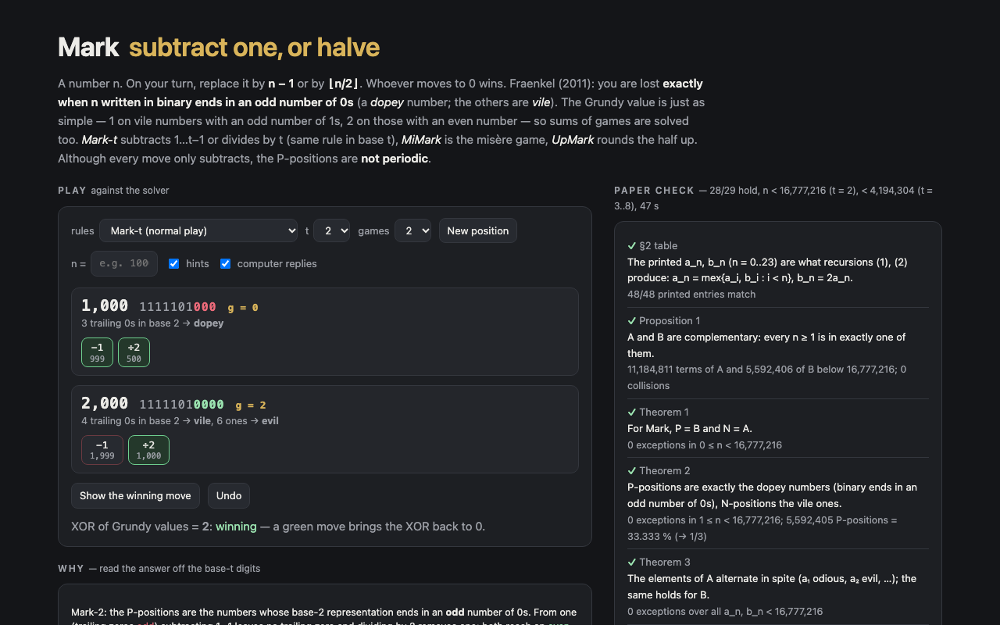

# Mark — subtract one, or halve

A browser implementation of Fraenkel's game **Mark** and its relatives, played against an exact solver. It also recomputes every checkable statement of the paper that introduced it by exhaustive search.



You start with a number n. On your turn, replace it by **n − 1** or by **⌊n/2⌋**. Whoever moves to 0 wins.

- **The answer is in binary.** n is a lost position (P-position) exactly when its binary representation ends in an **odd number of 0s**. Fraenkel calls these numbers *dopey* and the others *vile*, a play on Berlekamp–Conway–Guy's *odious* and *evil*.
- **Grundy values too.** The value of a vile number is 1 if it has an odd number of 1s (odious) and 2 if even (evil). So sums of several games are solved by XOR, and the demo plays them.
- **Variants.** *Mark-t* subtracts 1…t−1 or divides by t; it is the same rule in base t. *MiMark* is the misère game (the last mover loses). *UpMark* rounds the half up and ends at 1.
- **Aperiodic.** Every move only makes n smaller, yet the P-positions never become periodic (Theorem 9). Classical subtraction games with a fixed subtraction set are always periodic.

## What the check finds

Source: A. S. Fraenkel, *Aperiodic subtraction games*, Electron. J. Combin. **18(2)** (2011) #P19.

`npm run verify` builds the mex tables for Mark, MiMark and UpMark up to n < 2²⁴ (16.8 million positions each) and for Mark-t, t = 3..8, up to 2²². It checks 29 statements and takes about 50 s.

| claim | result |
|---|---|
| all four printed tables (§2, §4, §5, §6) and the g(0..23) table of §3 | every entry matches the recursions |
| Proposition 1, Theorems 1–3 (Mark: P = B = dopey numbers, spite alternates) | 0 exceptions below 2²⁴; P-density 33.333 % |
| Theorem 4 (i)–(v), Note 3 (structure of the ternary word W = g(0) g(1) …) | 0 exceptions; the four chains 010, 020, 01210, 02120 occur 1,398,101 times each |
| Theorems 5–6 (MiMark: dopey numbers with the powers of 2 swapped) | 0 exceptions; misère and normal play differ at only 24 positions |
| Theorem 7, Corollary 1 (UpMark) | 0 exceptions |
| **Theorem 8, as printed**: P = 1 and numbers ending in 1 0^{2k} 1 or in **1 0 1^k** (k > 1) | **2,097,153 exceptions**. It misses 3 = 11, 7 = 111, 19 = 10011, … The proof works with "ends in **1^k**" (n ≡ 3 mod 4), and that version has 0 exceptions |
| §6 Mark-t (P = base-t dopey numbers), t = 2..8 | 0 exceptions |
| Theorem 9 (aperiodic), finite check | no shift r ≤ 4,096 is a period on [M/4, M) for any t |
| **own:** misère Mark-t for every t = 2..8 is the base-t dopey set with the powers of t swapped (§7 lists misère Mark-t as open) | 0 exceptions up to 2²² |
| **own:** every N-position of Mark-t has **exactly one** winning move | true for t = 2..8 |
| **own:** P-density is exactly Σ_{j odd} (t−1)/t^{j+1} → 1/(t+1); Grundy values fill 0..t | holds |

The page's "paper check" panel reads `runs/verify.json`, so the numbers there are not typed by hand.

## Run

```sh
npm install
npm run dev        # demo at http://localhost:5173/portfolio/mark-game/
npm test           # 11 tests
npm run verify     # paper check (about 50 s), writes runs/verify.json
npm run build
```

`src/mark.ts` holds the game logic, with no dependencies: the move rules, mex tables (normal, misère, UpMark), the closed forms (vile/dopey in base t, odious/evil, Theorem 8 both as printed and as proved), the paper's recursions for A and B, and the solver for sums.

## License

MIT © 2026 SEN LLC
